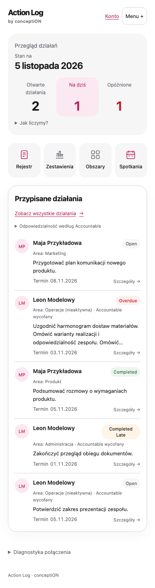
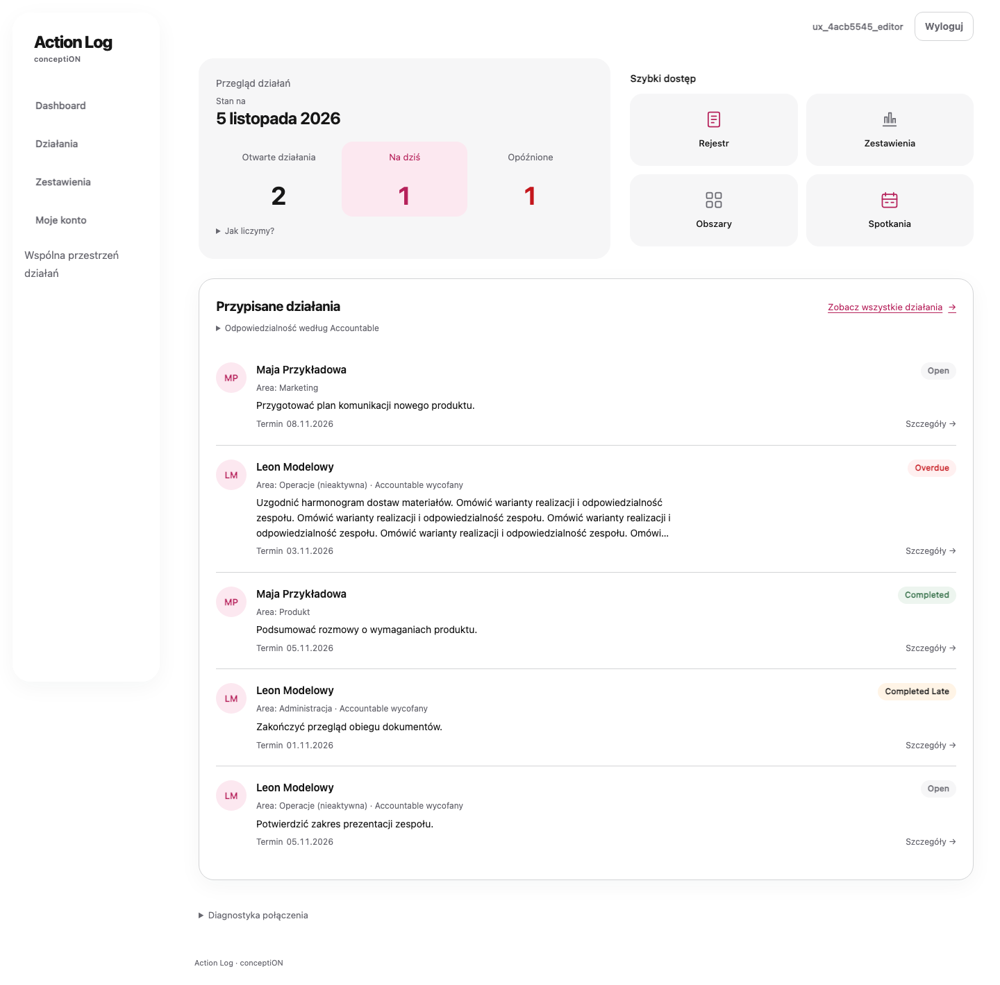

# Action Log — Product Documentation & AI-Assisted Delivery

**A real local product pilot, documented through a living specification, decision records and verification evidence.**

Action Log is a Django/PostgreSQL web application designed to make team actions, owners, deadlines, history and reporting easier to manage than a growing spreadsheet-based workflow.

**My role:** product direction, requirements and acceptance decisions, UX feedback, and directing AI-assisted implementation and verification. An AI coding agent supported engineering, tests and documentation. This is a case study of the product and delivery process, not a claim that I personally wrote every line of code.

## Start here

1. [Product specification](product/PRODUCT_SPEC.md) — what the product does, key behaviours and acceptance criteria.
2. [Decisions and trade-offs](decisions/DECISIONS.md) — how priorities, data integrity and UX choices were handled.
3. [AI delivery and validation](quality/DELIVERY_AND_VALIDATION.md) — what was delegated, what was verified, and what remains open.

## What the working local pilot includes

- Action registration and editing, filtering, sorting and assignment
- Role-based access and controlled dictionary management
- Immutable change-history records and stale-edit conflict handling
- Status calculations, summaries, charts and a redesigned Home screen

## Product screens

| Mobile Home | Desktop Home |
|---|---|
|  |  |

*Screenshots use synthetic demonstration data.*

## What I learned

Automated tests established that a technically working application existed, but did not settle whether it was a good product experience. I rejected several Home designs that did not match the intended information hierarchy. The agreed direction reorganised the page into a clear overview, four navigation modules and a person-centred list of assigned actions, without discarding tested business logic.

**Status (5 November 2026):** local v0.1 release candidate. Automated technical checks passed. Final visual/manual acceptance and public hosting are **not** complete. The repository documents the product; it is not the application source-code repository.

**Document provenance:** This small English presentation repository was curated retrospectively from an evolving product specification, dated decisions, saved agent task requests and recorded QA results. It is not presented as an original standalone PRD or as an unaltered history of all prompts.
